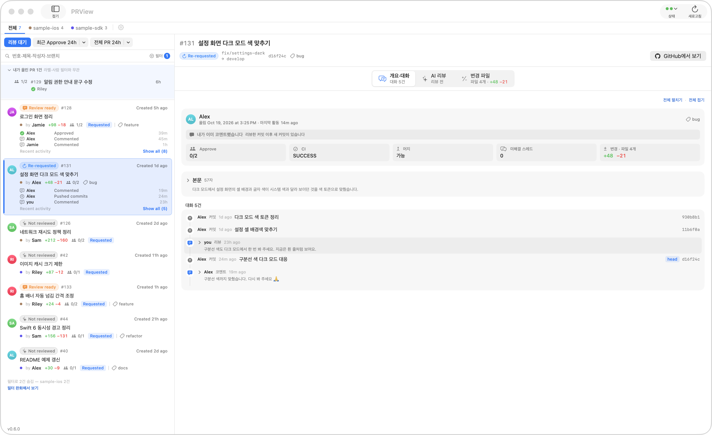
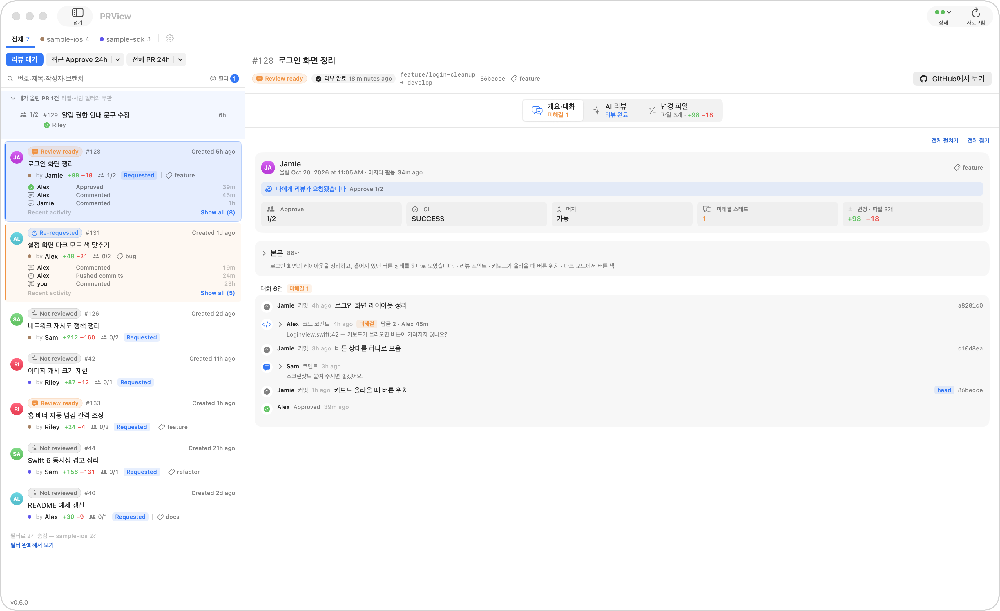
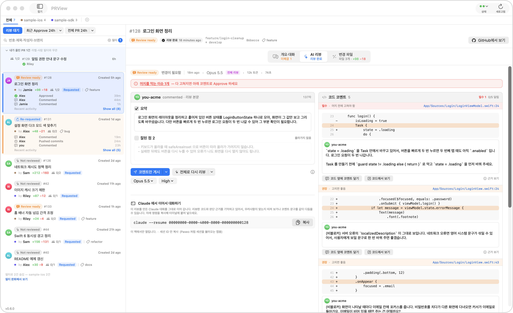
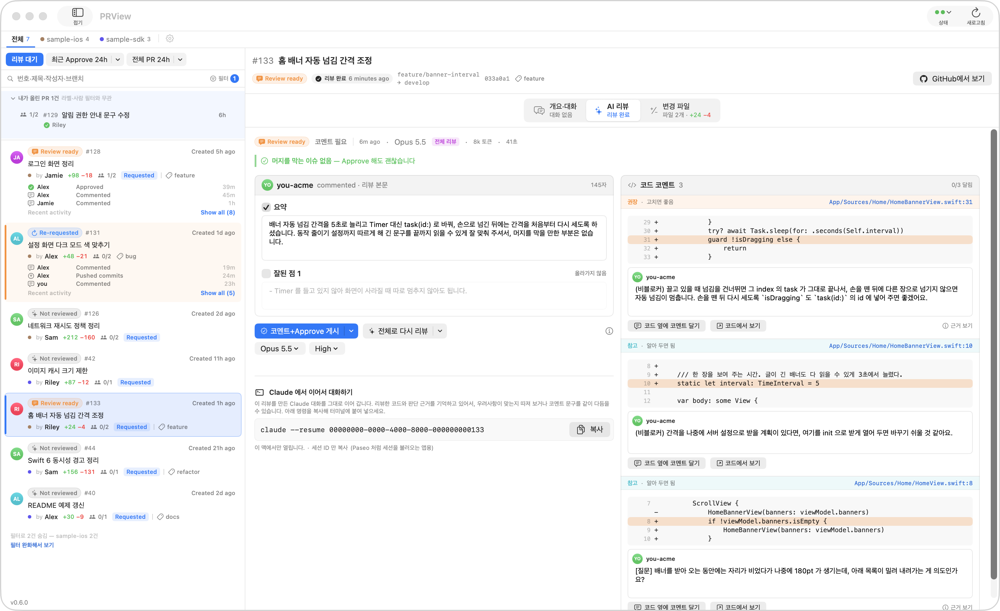
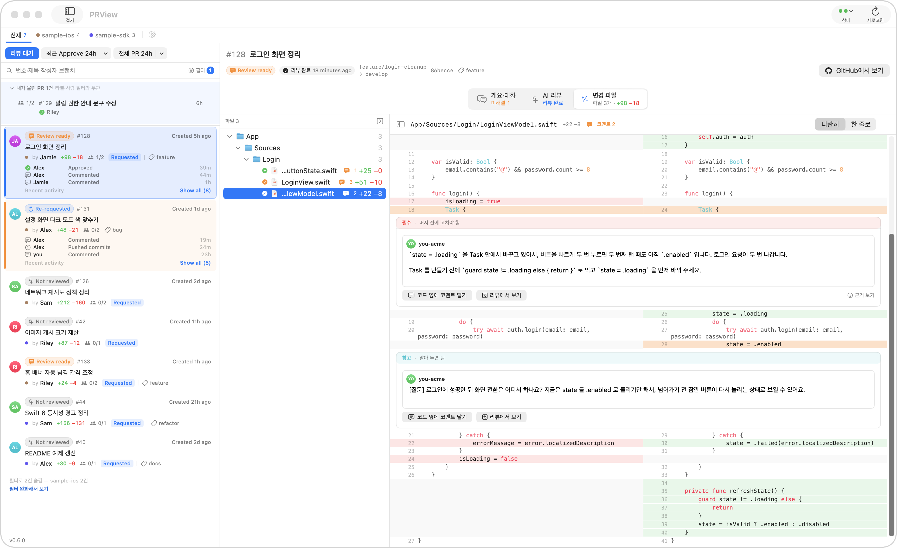

# PRView - PR Review Manager

팀 GitHub PR 을 한눈에 보고, **내 맥에 설치된 Claude Code**(또는 Codex)로 리뷰 초안을 만들고,
내가 확인한 것만 GitHub 리뷰로 올리는 macOS 앱입니다.

> 예전 이름은 PRayer 입니다. 앱 파일(`PRayer.app`)·번들 ID 는 업데이트가 끊기지 않게 그대로 둡니다.

## 화면

### PR 목록



리뷰를 기다리는 PR과 내가 올린 PR을 한 목록에서 봅니다. 내가 리뷰한 뒤 새 커밋이 올라오면 `Re-requested` 로 알려 줍니다.

### 개요·대화



PR 정보와 본문, 커밋·코드 코멘트·리뷰가 오간 흐름을 시간순으로 봅니다.

### AI 리뷰



왼쪽은 리뷰 본문, 오른쪽은 코드 줄에 달 코멘트입니다. 코멘트는 필수·권장·참고로 나뉘고, 머지를 막는 이슈(필수)가 있으면 위에 붉은 줄로 알려 주며 그 코멘트를 맨 위에 모읍니다.



막는 이슈가 없으면 초록 줄로 Approve 해도 괜찮다고 알려 줍니다. 남은 코멘트는 권장·참고입니다.

### 변경 파일



바뀐 파일을 나란히 보고, 코드 코멘트는 그 줄 바로 아래에 펼쳐집니다.

<sub>화면의 저장소·PR·사람 이름은 모두 데모용 가짜 데이터입니다.</sub>

## 설치 · 업데이트

터미널에 한 줄이면 `gh` 확인, 앱 내려받기, 설치까지 합니다. 업데이트도 같은 명령입니다.

```bash
curl -fsSL https://raw.githubusercontent.com/itaehyeok/PRView/main/Scripts/setup.sh | bash
```

설치한 뒤에는 새 버전이 나오면 창 위에 안내가 뜹니다 → `앱에서 업데이트`.
[릴리스](https://github.com/itaehyeok/PRView/releases/latest)에서 zip 을 직접 받아도 됩니다(공증돼 있습니다).

### 필요한 것

- macOS 14 이상, Apple Silicon
- [Claude Code](https://code.claude.com) 설치·로그인 — `claude auth login` (Codex 로 리뷰하려면 Codex CLI)
- [GitHub CLI](https://cli.github.com) 로그인 — `gh auth login`

앱은 토큰을 따로 저장하지 않고 이 맥의 `gh`·`claude` 로그인을 그대로 씁니다.
리뷰 초안은 이 맥에서만 만들어지고, 직접 게시 버튼을 눌러야 GitHub 에 올라갑니다.

팀원과 같은 레포·규칙으로 시작하려면, 먼저 쓰던 사람이 설정 → `설정 공유` 탭 → `내보내기…`로 파일을
만들어 보냅니다. 받는 사람은 온보딩 레포 단계의 `팀원 설정 가져오기…`(또는 같은 탭의 `가져오기…`)로 엽니다.
항목마다 지금 값과 견줘 보며 고른 것만 들어오고, 토큰·실행 파일 경로는 파일에 담기지 않습니다.

---

## 직접 빌드하기

### 준비물
- macOS 14+ / Xcode 26+
- [Claude Code](https://code.claude.com) 로그인 (`claude auth login`)
- [gh CLI](https://cli.github.com) 로그인 (`gh auth login`, scope `repo`, `read:org`)
- 빌드 도구: `brew install xcodegen`

```bash
bash Scripts/doctor.sh    # 빠진 것과 고치는 방법을 알려 준다
```
통과하면 아래 빌드로 넘어간다. **계정은 각자 것을 쓴다** — 앱은 토큰을 저장하지 않고
이 맥의 `gh`·`claude` 로그인을 그대로 빌려 쓴다. 볼 레포도 앱 설정에서 각자 추가한다.

### 서명
알림을 받으려면 **실제 Apple Development 인증서**로 서명해야 한다(ad-hoc 서명은
`UNUserNotificationCenter` 가 거부한다). 팀 ID 는 `Scripts/gen.sh` 가 이 맥의 인증서에서
자동으로 찾으므로 보통 아무것도 안 해도 된다.

- 인증서가 없으면: Xcode → Settings → Accounts 에서 Apple ID 로그인(**무료 계정도 된다**)
- 팀이 여럿이거나 자동 감지가 틀리면: `echo 'PRAYER_TEAM_ID=ABCDE12345' > Local.env`
  (`Local.env` 는 커밋되지 않는다)

빌드한 `.app` 을 그대로 남에게 주는 것은 안 된다 — 개발용 서명이라 Gatekeeper 가 막는다.

### 빌드·실행
```bash
bash Scripts/gen.sh       # project.yml → PRayer.xcodeproj
bash Scripts/install.sh   # 빌드 후 ~/Applications/PRayer.app 에 설치
open ~/Applications/PRayer.app
```
첫 실행 때 알림 권한을 **허용** 해야 리뷰 완료 알림이 온다.
`~/Applications` 에서 실행할 것 — DerivedData 경로에서 직접 띄우면 알림이 등록되지 않는다.

### 테스트
```bash
bash Scripts/test.sh                       # 단위 테스트
bash Scripts/test.sh --integration         # 실제 gh 호출까지 (토큰 안 씀)
bash Scripts/test.sh --review <PR 번호>    # 실제 Claude 리뷰 1건 (토큰 씀)
```
실측 명령은 진짜 레포가 있어야 돈다 — `echo 'PRAYER_TEST_REPO=owner/name' >> Local.env`.
스크립트는 `bash Scripts/...` 형식으로 실행한다. `./Scripts/test.sh` 로 직접 실행하면
일부 환경에서 xcodebuild 가 테스트 번들을 로드하지 못해 실패한다(원인 미확인).
Xcode에서 열려면 `PRayer.xcodeproj`. App Sandbox는 **꺼져 있어야** 한다(`claude`/`gh` 실행 때문).

### 배포 (저장소 주인)

```bash
git config core.hooksPath Scripts/git-hooks   # push 전 검사 — 클론마다 한 번
bash Scripts/release.sh --beta                # 1) 시험판(pre-release)으로 — 앱 업데이트·setup.sh 는 고르지 않는다
bash Scripts/beta.sh                          #    이 맥에 깔아 써 본다 (되돌리기: 이전 베타 이름)
RELEASE_NOTES_FILE=notes.md bash Scripts/release.sh 0.6.4 --promote
                                              # 2) 써 본 그 zip 을 다시 빌드하지 않고 정식으로
```

`Local.env` 의 `PRAYER_TEAM_ID` 로 **Developer ID Application** 인증서를 골라 서명하고,
서명된 팀이 정말 그 팀인지 확인한 뒤에야 zip 을 만든다. 공증 자격 증명이 있으면 공증까지 한다:

```bash
xcrun notarytool store-credentials PRayer-notary --apple-id <your@apple.id> --team-id <TEAM_ID>
```

공개할 때 `terry-yes/PRView` 에도 같은 zip 을 올린다 — 0.6.0~0.6.3 앱이 그 저장소에 새 버전을 묻기 때문이다.

## 구조
- `Sources/PRayerCore` — 프레임워크. GitHub 조회/게시, Claude·Codex 실행, diff 파싱, 초안 검증, 큐, 저장소
- `Sources/PRayer` — SwiftUI 앱. 온보딩 위저드, PR 목록, 상세, 리뷰 결과, 게시 시트
- `Resources/review.md` — 리뷰 시스템 프롬프트(리뷰 가이드)
- `Resources/schema.json` — 구조화 출력 스키마
- `Tests/PRayerCoreTests` — Core 단위 테스트

## 원칙
- 초안은 **로컬에만** 저장한다. "게시"를 누를 때만 GitHub에 올라간다. 자동 게시 경로는 코드에 없다.
- Claude 프로세스에는 도구를 주지 않는다(`--tools ""`). 자식 환경에서 GitHub 토큰을 제거한다.
- 리뷰한 Claude 대화는 이 맥의 `~/.claude/projects` 에 남는다. 리뷰 맨 아래 "Claude 에서 이어서 대화하기"
  의 명령(`claude --resume <ID>`)을 터미널에 붙여 넣으면 그 대화를 이어 간다.
- 앱은 비밀번호·토큰을 입력받지 않는다. GitHub 인증은 `gh` 로그인을 재사용한다.
